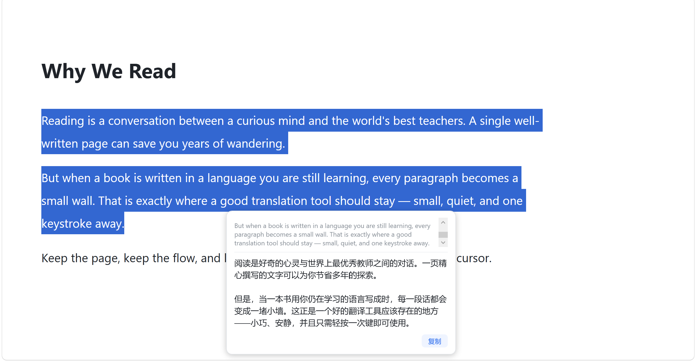

# 📖 Picklingo-Translate

> **Select text anywhere, press the hotkey, read the translation right next to your cursor.**
> One keystroke, an instant card, zero interruption — your clipboard stays exactly as you left it.

> **在任何地方选中文字，按下快捷键，译文就在鼠标旁弹出来。**
> 一次按键、秒出卡片、不打断手头的事——连剪贴板都帮你原样留着。

[English](#english) · [中文](#中文)



---

# English

## ✨ Features

- 🌍 **Chinese ⇄ English, direction auto-detected** — text containing Chinese is translated to English, anything else to Chinese
- ⌨️ **Global hotkey** — default `Alt+Q`, configurable in `picklingo.ini`
- 🪟 **Non-intrusive popup** — appears next to your cursor, never steals focus, click anywhere outside to dismiss
- 📋 **Clipboard guardian** — your clipboard is backed up and restored around every lookup (whatever you were copying stays put)
- 🔢 **Smart filtering** — pure numbers/symbols are ignored; digits, prices and model names (e.g. `i7-13700K`, `$29.99`) stay untouched in the translation
- 🖥️ **Lives in the tray** — auto-start at login, no window, no clutter
- 🆓 **Free by default** — uses the free Bing translator endpoint (no API key, no registration), with MyMemory as an automatic fallback
- 🔒 **Private** — only the text you selected is sent to the translation service; no history, no accounts, no telemetry

## 🚀 Quick Start

1. Download `Picklingo-v1.0.0-win-x64.zip` from [Releases](https://github.com/Edison-q/Picklingo-Translate/releases) and unzip it anywhere
2. Run `Picklingo.exe` (it appears in the system tray)
3. Select text in any app → press **Alt+Q** → read the card; click anywhere outside to close it

> Windows SmartScreen may warn on first run (the binary is not code-signed): click **More info → Run anyway**.

No installer, no dependencies — the zip is self-contained (Windows x64).

## ⚙️ Configuration

`picklingo.ini` (next to `Picklingo.exe`) is created on first run:

```ini
hotkey=Alt+Q   # Ctrl/Alt/Shift/Win + one letter or digit
```

Change it and restart the app. The tray menu offers pause/resume and quit.

## 🛠 Build from Source

Requirements: [.NET 10 SDK](https://dotnet.microsoft.com/download) (Windows)

```bash
git clone https://github.com/Edison-q/Picklingo-Translate.git
cd Picklingo-Translate/src/Picklingo
dotnet build -c Release
dotnet publish -c Release -r win-x64 --self-contained true -o ../../app
```

Tech stack: **C# / .NET 10 + WPF** — global hotkey (`RegisterHotKey`), simulated copy (`SendInput`, waits for modifier keys to be physically released), native Win32 clipboard read/restore, a `WS_EX_NOACTIVATE` popup that never steals focus, and a low-level mouse hook for click-away dismissal.

## ⚠️ Known Limitations

- Apps that draw their own text surfaces (a few games and specialized tools) may not expose selections — a common limitation of every select-to-translate tool
- If the target window runs as administrator, Picklingo must also run as administrator to capture from it
- In terminals, pressing the hotkey **without a selection** may send a Ctrl+C to the terminal — select text first (a UIA-based capture is on the roadmap)
- Translation depends on a free third-party endpoint; if it ever changes, the built-in MyMemory fallback keeps working

## 🗺 Roadmap

- [ ] UIA-based text capture (fixes terminal windows, removes the Ctrl+C caveat)
- [ ] More engines (DeepSeek / Baidu) selectable in `picklingo.ini`
- [ ] Popup styling / dark mode
- [ ] History & favorites

## 📄 License

[MIT](LICENSE) © [Edison-q](https://github.com/Edison-q)

---

# 中文

## ✨ 功能

- 🌍 **中英互译、方向自动判断** —— 含中文的译成英文，其余译成中文
- ⌨️ **全局快捷键** —— 默认 `Alt+Q`，可在 `picklingo.ini` 里修改
- 🪟 **不打扰的弹窗** —— 出现在鼠标旁、不抢焦点，点外面任意处即关
- 📋 **剪贴板保护** —— 取词前后自动备份/还原剪贴板（你原来复制的东西不会被弄丢）
- 🔢 **智能过滤** —— 纯数字/符号直接忽略；译文里的数字、价格、型号（如 `i7-13700K`、`$29.99`）原样保留
- 🖥️ **托盘常驻** —— 开机自启、无窗口、不占地方
- 🆓 **默认零成本** —— 走免费 Bing 翻译通道（无需注册、无需 key），MyMemory 自动兜底
- 🔒 **注重隐私** —— 只把你选中的文字发给翻译服务；无历史记录、无账号、无遥测

## 🚀 快速开始

1. 到 [Releases](https://github.com/Edison-q/Picklingo-Translate/releases) 下载 `Picklingo-v1.0.0-win-x64.zip`，解压到任意位置
2. 双击 `Picklingo.exe`（会出现在右下角托盘）
3. 在任何软件里选中文字 → 按 **Alt+Q** → 看鼠标旁的卡片，点外面关闭

> 首次运行 Windows 可能弹 SmartScreen 警告（程序未签名）：点「更多信息 → 仍要运行」即可。

免安装、无依赖——压缩包是自包含的（Windows x64）。

## ⚙️ 配置

首次运行会在 `Picklingo.exe` 同目录生成 `picklingo.ini`：

```ini
hotkey=Alt+Q   # 修饰键(Ctrl/Alt/Shift/Win) + 一个字母或数字
```

改完重启程序生效。托盘右键菜单可暂停取词 / 退出。

## 🛠 从源码构建

环境要求：[.NET 10 SDK](https://dotnet.microsoft.com/download)（Windows）

```bash
git clone https://github.com/Edison-q/Picklingo-Translate.git
cd Picklingo-Translate/src/Picklingo
dotnet build -c Release
dotnet publish -c Release -r win-x64 --self-contained true -o ../../app
```

技术栈：**C# / .NET 10 + WPF** —— 全局热键（`RegisterHotKey`）、模拟复制（`SendInput`，等修饰键物理松开）、原生 Win32 剪贴板读写与还原、不抢焦点的弹窗（`WS_EX_NOACTIVATE`）、低级鼠标钩子实现「点外面关闭」。

## ⚠️ 已知限制

- 完全自绘文字界面的应用（部分游戏、个别工具）可能取不到选中文字——这是所有同类工具的共同限制
- 目标窗口以管理员权限运行时，Picklingo 也需要以管理员权限运行
- 在终端里**未选中文字**就按快捷键，可能向终端发送 Ctrl+C——请先选中文字（计划用 UIA 取词解决）
- 翻译依赖第三方免费接口；若接口变更，内置的 MyMemory 兜底仍可用

## 🗺 路线图

- [ ] UIA 取词（解决终端场景，去掉 Ctrl+C 注意事项）
- [ ] 更多翻译引擎（DeepSeek / 百度）可在 `picklingo.ini` 选择
- [ ] 弹窗样式 / 深色模式
- [ ] 历史记录与收藏

## 📄 许可证

[MIT](LICENSE) © [Edison-q](https://github.com/Edison-q)
